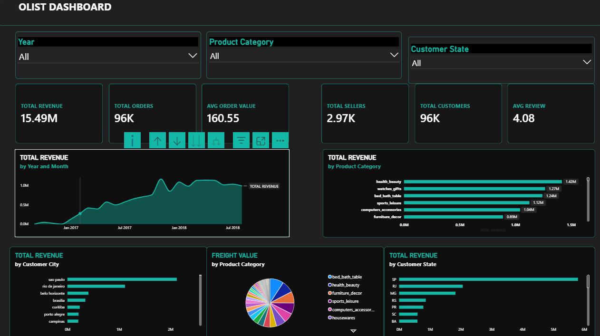

# Olist-Ecommerce-Sales-Analysis

Brazilian e-commerce sales analysis using the Olist dataset.

## KPIs
- **Total Revenue:** 15.49M
- **Total Orders:** 99K
- **Total Customers:** 96K
- **Total Sellers:** 3.09K
- **Avg Order Value:** 160.55
- **Avg Review Score:** 4.08

## Key Insights & Analysis

**1. Overall Performance**
Total Revenue is 15.49M from 99K orders, with 96K customers and 3.09K sellers.
Avg Order Value is 160.55 and Avg Review Score is 4.08/5 — customers are generally satisfied.

**2. Revenue Growth**
Revenue grew from 2016 (0.03M) to 2017 (7.27M) and peaked in 2018 (8.02M).
Peak months were Nov 2017 (1.19M) and Aug 2018 (0.99M).

**3. Top Categories**
- Health & Beauty: 1.26M
- Bed Bath Table: 1.03M
- Sports Leisure: 0.99M
- Furniture Decor: 0.82M
- Computers Accessories: 0.80M
Health & Beauty is the clear leader.

**4. Geography**
By State: Sao Paulo (SP) = 6.36M (41% of total), Rio de Janeiro (RJ) = 2.51M, Minas Gerais (MG) = 1.77M.
By City: Sao Paulo = 4.09M, Rio de Janeiro = 2.19M, Belo Horizonte = 1.09M.
Revenue is highly concentrated in SP.

**5. Freight Cost**
Highest freight is Furniture Decor (0.42M) and Bed Bath Table (0.32M) — bulky items cost more to ship.

**6. Recommendation**
- Push Health & Beauty and Bed Bath Table — high revenue, lower freight.
- Optimize logistics for Furniture.
- Expand marketing beyond SP to reduce dependence on one state.

## Features
- Interactive slicers: Year, Product Category, Customer State
- Revenue by Year & Month, Category, City, State
- Freight Value by Category

## Files in this Repo
- `olist-brazil-ecommerce-sales-analysis.pbix` - Power BI Dashboard
- `sql/` - SQL queries for analysis
- `screenshots/` - Dashboard preview

## Tools
Power BI | DAX | Power Query | SQL
